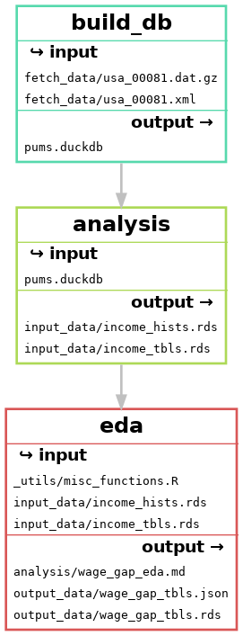

Prep wage gaps analysis for an updated interactive visualization. 

## Setup

PUMS data are stored in the repo via git large file storage. Because the microdata file is too large to fit in memory on many laptops, and too compute-intensive, it's loaded into a duckdb database first, then analysis is done on the data in the database. 

With snakemake, call 

``` bash
snakemake build_db
```

to rebuild the database. 

```{bash}
#| echo: false
#| include: false
snakemake --filegraph eda | dot -Tpng > dag.png
```

Snakemake DAG: 



