# wage gap EDA


## setup

``` r
library(tidyverse)
library(showtext)

showtext_opts(dpi = 150)
sysfonts::font_add_google("Barlow Semi Condensed")

source(here::here("_utils/misc_functions.R"))
vivid <- rcartocolor::carto_pal(12, "Vivid")
pal <- setNames(c(
  vivid[c(1:8, 12)],
  vivid[1:4],
  "gray30"
  ), c(
    "Men", "Women", "White", "Black", "Latino", "API", "Other race", "Full-time", "Part-time", 
    "High school or less", "Some college or AA", "Bachelors", "Graduate degree",
    "Total"))

vir_pal <- viridisLite::turbo(n = 5)

theme_bar <- function(...) {
  camiller::theme_din(base_family = "Barlow Semi Condensed") +
    theme(...)
}

theme_set(theme_bar())

out <- list()
```

``` r
make_bars <- function(data, x = sex, y = income, fill = sex, 
                      position = position_dodge2(), 
                      y_labels = scales::label_dollar(accuracy = 1, scale = 1e-3, suffix = "k"),
                      legend = TRUE) {
  gg <- ggplot(data, aes(x = {{x}}, y = {{y}}, fill = {{fill}}))
  gg <- gg + geom_col(position = position, alpha = 0.9)
  gg <- gg + scale_fill_manual(values = pal) 
  gg <- gg + stylehaven::scale_y_barcontinuous(labels = y_labels)
  gg <- gg + facet_grid(cols = vars(name), scales = "free_x")
  if (!legend) {
    gg <- gg + theme(legend.position = "none")
  }
  gg
}

make_dots <- function(data, x = race, y = income, color = sex, 
                      y_labels = scales::label_dollar(accuracy = 1, scale = 1e-3, suffix = "k"),
                      legend = TRUE, flip = TRUE) {
  gg <- ggplot(data, aes(x = {{x}}, y = {{y}}, color = {{color}}))
  gg <- gg + geom_path(color = "gray80", linewidth = 3)
  gg <- gg + geom_point(size = 5)
  gg <- gg + scale_color_manual(values = pal) 
  gg <- gg + scale_y_continuous(labels = y_labels)
  # gg <- gg + facet_grid(cols = vars(name), scales = "free_x")
  if (!legend) {
    gg <- gg + theme(legend.position = "none")
  }
  if (flip) {
    gg <- gg + coord_flip()
  }
  gg
}

make_quants <- function(data, x = sex, quant = c("q20", "q25", "q50", "q75", "q80"), facet = race,
                        y_labels = scales::label_dollar(accuracy = 1, scale = 1e-3, suffix = "k"),
                        legend = TRUE, flip = FALSE) {
  data |>
    mutate(quant_num = parse_number(as.character(quant))) |>
    mutate(bracket = 100 - abs(quant_num - 50))
  gg <- ggplot(data, aes(x = {{x}}, y = income, color = quant, group = {{x}}))
  gg <- gg + geom_path(linewidth = 3, color = "gray80")
  gg <- gg + geom_point(aes(size = bracket), alpha = 0.8)
  gg <- gg + scale_y_continuous(labels = y_labels)
  gg <- gg + scale_color_viridis_d(option = "turbo", direction = -1)
  gg <- gg + scale_size_continuous(range = c(5, 10), guide = guide_none())
  gg <- gg + facet_grid(cols = vars({{facet}}))  
  if (flip) {
    gg <- gg + coord_flip()
  }
  gg
}
```

force NA values for very small groups–only affects calcs by occupation
group (production, natural resources, military)

``` r
wages <- readRDS(here::here("input_data/income_tbls.rds")) |>
  bind_rows(.id = "dim") |>
  separate(dim, into = c("univ", "dim"), sep = "\\.") |>
  mutate(time = ifelse(is_fulltime | univ == "full_time", "Full-time", "Part-time")) |>
  mutate(edu = as.character(edu)) |>
  mutate(across(c(sex, race, occ_group, time, edu), \(x) replace_na(x, "Total"))) |>
  select(univ, dim, name, time, edu, sex, race, occ_group, count, sample_n, everything(), -is_fulltime) |>
  mutate(across(c(univ, dim, name, time, edu, sex, race, occ_group), as_factor)) |>
  mutate(across(c(time, edu, sex, race, occ_group), \(x) fct_relevel(x, "Total"))) |>
  mutate(univ = fct_relevel(univ, "all_time") |> fct_relabel(str_remove, "_time")) |>
  mutate(dim = fct_relevel(dim, "total", "sex", "time", "sex_x_time", "race", "edu", "occ") |>
           fct_relevel("sex_x_edu_x_occ", after = Inf),
         sex = fct_relevel(sex, "Total", "Male") |> fct_recode(Men = "Male", Women = "Female"),
         race = fct_relevel(race, "Total", "White", "Black", "Latino") |> fct_recode("Other race" = "Other")) |>
  mutate(is_small = sample_n < 30 | count < 100) |>
  filter(name %in% c("US", "Connecticut")) |>
  mutate(across(where(is.factor), fct_drop))

summary(wages)
```

       univ                  dim               name            time    
     all : 18   sex_x_edu_x_occ:143   US         :157   Total    :  6  
     full:295   race_x_edu     : 40   Connecticut:156   Full-time:301  
                sex_x_occ      : 36                     Part-time:  6  
                race_x_sex     : 20                                    
                occ            : 18                                    
                sex_x_edu      : 16                                    
                (Other)        : 40                                    
                      edu         sex              race    
     Total              :106   Total: 82   Total     :243  
     High school or less: 52   Men  :116   White     : 14  
     Some college or AA : 52   Women:115   Black     : 14  
     Bachelors          : 52               Latino    : 14  
     Graduate degree    : 51               API       : 14  
                                           Other race: 14  
                                                           
                                                    occ_group       count          
     Total                                               :116   Min.   :       25  
     Computer, Engineering, and Science                  : 22   1st Qu.:    26144  
     Education, Legal, Community Service, Arts, and Media: 22   Median :   224656  
     Healthcare Practitioners and Technical              : 22   Mean   :  5022127  
     Management, Business, and Financial                 : 22   3rd Qu.:  2856804  
     Natural Resources, Construction, and Maintenance    : 22   Max.   :149258984  
     (Other)                                             : 87                      
        sample_n          count_se        earn_q20         earn_q25     
     Min.   :      1   Min.   :   22   Min.   :  6000   Min.   :  8038  
     1st Qu.:   1207   1st Qu.: 1086   1st Qu.: 30000   1st Qu.: 33900  
     Median :  11195   Median : 3038   Median : 38000   Median : 42086  
     Mean   : 231074   Mean   : 8112   Mean   : 41641   Mean   : 45822  
     3rd Qu.: 126729   3rd Qu.:11051   3rd Qu.: 50991   3rd Qu.: 56657  
     Max.   :6946344   Max.   :57125   Max.   :103340   Max.   :105215  
                                                                        
        earn_q50         earn_q75         earn_q80       earn_q20_se     
     Min.   : 17564   Min.   : 34447   Min.   : 35000   Min.   :    0.0  
     1st Qu.: 48641   1st Qu.: 74583   1st Qu.: 80000   1st Qu.:  134.2  
     Median : 62323   Median : 90000   Median : 99895   Median :  387.5  
     Mean   : 67381   Mean   :100232   Mean   :111234   Mean   :  990.3  
     3rd Qu.: 80665   3rd Qu.:120000   3rd Qu.:130935   3rd Qu.: 1318.5  
     Max.   :172946   Max.   :370000   Max.   :460468   Max.   :10319.0  
                                                        NA's   :7        
      earn_q25_se       earn_q50_se     earn_q75_se       earn_q80_se   
     Min.   :    0.0   Min.   :    0   Min.   :    0.0   Min.   :    0  
     1st Qu.:  129.5   1st Qu.:  177   1st Qu.:  261.0   1st Qu.:  296  
     Median :  474.0   Median :  610   Median :  957.5   Median :  993  
     Mean   : 1126.2   Mean   : 1628   Mean   : 2180.8   Mean   : 2794  
     3rd Qu.: 1358.0   3rd Qu.: 1702   3rd Qu.: 2461.5   3rd Qu.: 2870  
     Max.   :11794.0   Max.   :26471   Max.   :27327.0   Max.   :96938  
     NA's   :5         NA's   :4       NA's   :5         NA's   :6      
      is_small      
     Mode :logical  
     FALSE:304      
     TRUE :9        
                    
                    
                    
                    

``` r
count(wages, univ, dim)
```

    # A tibble: 13 × 3
       univ  dim                 n
       <fct> <fct>           <int>
     1 all   total               2
     2 all   sex                 4
     3 all   time                4
     4 all   sex_x_time          8
     5 full  sex                 4
     6 full  race               10
     7 full  edu                 8
     8 full  occ                18
     9 full  race_x_edu         40
    10 full  race_x_sex         20
    11 full  sex_x_edu          16
    12 full  sex_x_occ          36
    13 full  sex_x_edu_x_occ   143

``` r
distros <- readRDS(here::here("input_data/income_hists.rds")) |>
  bind_rows(.id = "dim") |>
  mutate(across(c(sex, race), \(x) replace_na(x, "Total"))) |>
  select(dim, name, bin, sex, race, count, sample_n, everything()) |>
  mutate(across(c(dim, name, sex, race), as_factor)) |>
  mutate(sex = fct_relevel(sex, "Total", "Male") |> fct_recode(Men = "Male", Women = "Female"),
         race = fct_relevel(race, "Total", "White", "Black", "Latino") |> fct_recode("Other race" = "Other")) |>
  filter(name %in% c("US", "Connecticut"))

summary(distros)
```

             dim               name                 bin         sex     
     sex       :166   Connecticut:1030   [0,10000)    : 17   Total:319  
     race      :319   Maryland   :   0   [10000,20000): 17   Men  :393  
     race_x_sex:545                      [20000,30000): 17   Women:318  
                                         [30000,40000): 17              
                                         [40000,50000): 17              
                                         [50000,60000): 17              
                                         (Other)      :928              
             race         count            sample_n         count_se     
     Total     :166   Min.   :    3.0   Min.   :   1.0   Min.   :   3.0  
     White     :256   1st Qu.:   42.0   1st Qu.:   2.0   1st Qu.:  28.0  
     Black     :125   Median :  245.5   Median :  13.0   Median :  83.0  
     Latino    :147   Mean   : 3500.4   Mean   : 165.6   Mean   : 213.5  
     API       :183   3rd Qu.: 1869.2   3rd Qu.:  89.0   3rd Qu.: 254.8  
     Other race:153   Max.   :82825.0   Max.   :4074.0   Max.   :1784.0  
                                                                         
         lower        
     Min.   :      0  
     1st Qu.: 150000  
     Median : 300000  
     Mean   : 360971  
     3rd Qu.: 507500  
     Max.   :1000000  
                      

## median individual earnings, adults 25+ with positive earnings

### full- and part-time

#### total wages, CT vs US

``` r
out[["total"]] <- wages |>
  filter(univ == "all",
         dim == "total") |>
  select(univ:occ_group, income = earn_q50)

make_bars(out$total, legend = FALSE)
```

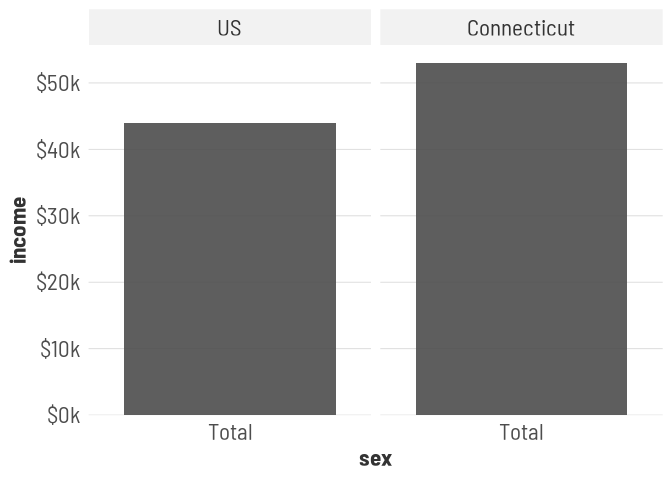

#### wages by sex

``` r
out[["all_by_sex"]] <- wages |>
  filter(univ == "all",
         dim == "sex") |>
  select(univ:occ_group, income = earn_q50)

make_bars(out$all_by_sex, legend = FALSE)
```

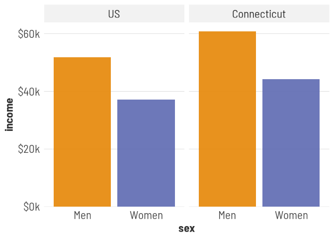

#### wages by time

``` r
out[["all_by_time"]] <- wages |>
  filter(dim == "time") |>
  select(univ:occ_group, income = earn_q50)

make_bars(out$all_by_time, x = time, fill = time, legend = FALSE)
```

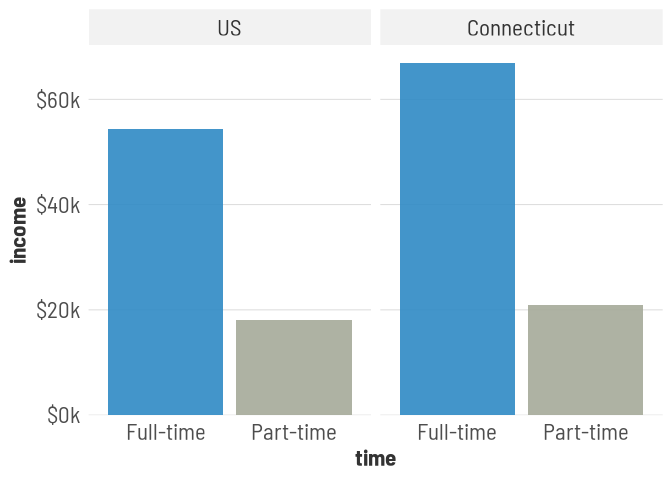

#### employment by sex x time

women more likely work part-time

``` r
out[["share_by_time"]] <- wages |>
  filter(univ == "all",
         dim == "sex_x_time") |>
  group_by(univ, dim, name, edu, sex, race, occ_group) |>
  mutate(share = stylehaven::round_sum100((count / sum(count)) * 100) / 100) |>
  ungroup() |>
  select(univ:occ_group, share)

make_bars(out$share_by_time, y = share, fill = fct_rev(time), position = position_fill(), 
            y_labels = scales::label_percent())
```

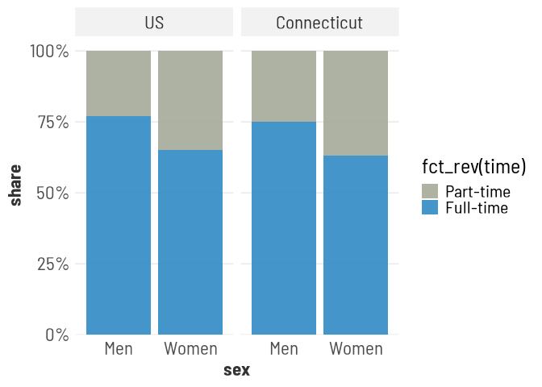

#### wages by sex x time

``` r
out[["all_by_sex_x_time"]] <- wages |>
  filter(univ == "all",
         dim == "sex_x_time") |>
  select(univ:occ_group, income = earn_q50)

make_bars(out$all_by_sex_x_time, x = time)
```

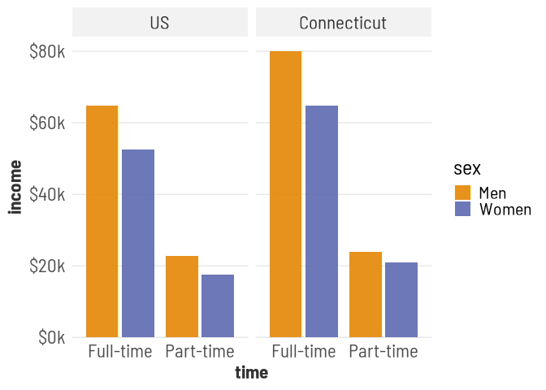

### full-time only

#### wages by sex

``` r
out[["full_by_sex"]] <- wages |>
  filter(univ == "full",
         dim == "sex") |>
  select(univ:occ_group, income = earn_q50)

make_bars(out$full_by_sex, legend = FALSE)
```

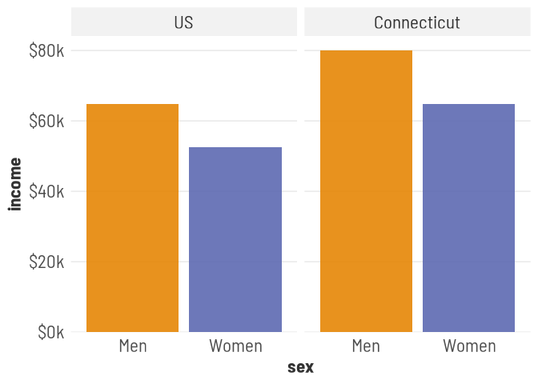

#### wages by race

``` r
out[["full_by_race"]] <- wages |>
  filter(univ == "full",
         dim == "race") |>
  select(univ:occ_group, income = earn_q50)

make_bars(out$full_by_race, x = race, fill = race, legend = FALSE)
```

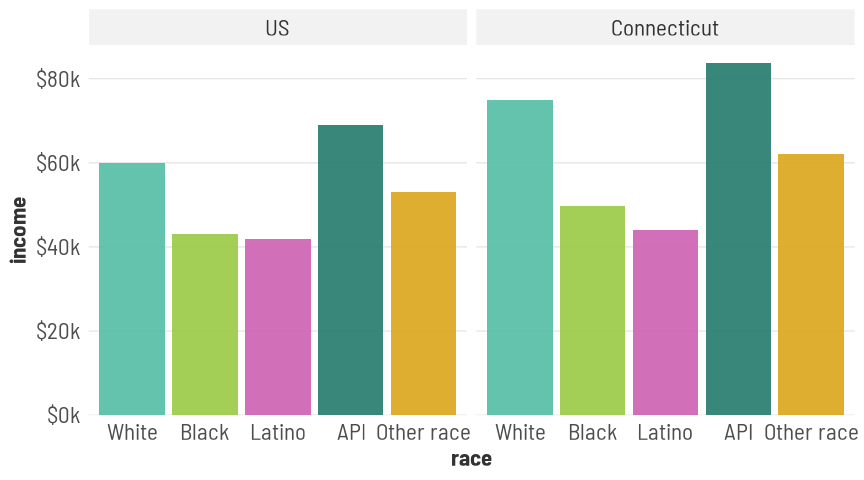

#### wages by edu

``` r
out[["full_by_edu"]] <- wages |>
  filter(univ == "full",
         dim == "edu") |>
  select(univ:occ_group, income = earn_q50)

make_bars(out$full_by_edu, x = edu, fill = edu, legend = FALSE) +
  scale_x_discrete(labels = scales::label_wrap(10))
```

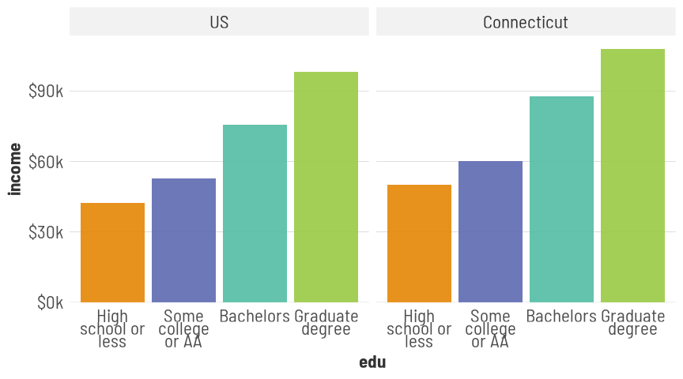

#### wages by sex x race

``` r
out[["full_by_race_x_sex"]] <- wages |>
  filter(univ == "full",
         dim %in% c("sex", "race_x_sex")) |>
  select(univ:occ_group, income = earn_q50) |>
  mutate(race = fct_reorder(race, income, .fun = max)) |>
  arrange(race)

out$full_by_race_x_sex |>
  filter(name == "Connecticut") |>
  make_dots()
```

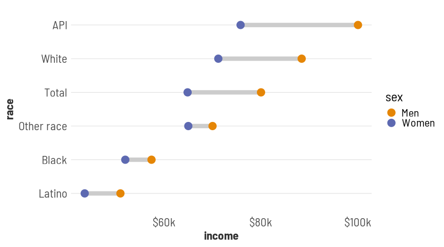

#### wages by sex x edu

``` r
out[["full_by_sex_x_edu"]] <- wages |>
  filter(univ == "full",
         dim %in% c("sex", "sex_x_edu")) |>
  select(univ:occ_group, income = earn_q50) |>
  mutate(edu = fct_reorder(edu, income, .fun = max)) |>
  arrange(edu)

out$full_by_sex_x_edu |>
  filter(name == "Connecticut") |>
  make_dots(x = edu)
```

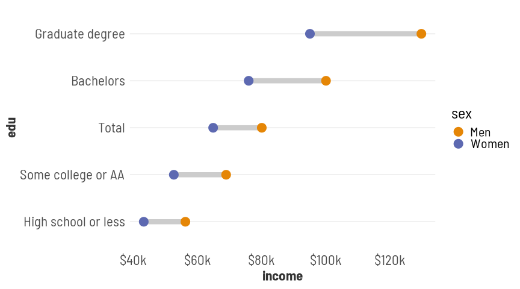

#### wages by occupation

``` r
out[["full_by_occ"]] <- wages |>
  filter(univ == "full",
         dim == "occ",
         !is_small) |>
  select(univ:occ_group, income = earn_q50) |>
  mutate(occ_group = fct_reorder(occ_group, income, .fun = max)) |>
  arrange(occ_group)

out$full_by_occ |>
  filter(name == "Connecticut") |>
  make_dots(x = occ_group, legend = FALSE) +
  scale_x_discrete(labels = \(x) substring(x, 1, 25))
```

    `geom_path()`: Each group consists of only one observation.
    ℹ Do you need to adjust the group aesthetic?

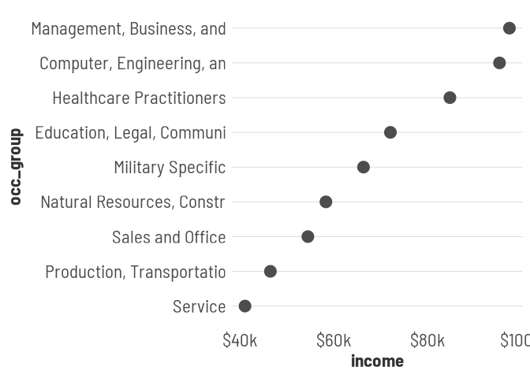

#### employment by occupation x sex

``` r
wages |>
  filter(univ == "full",
         name == "Connecticut",
         dim == "sex_x_occ") |>
  group_by(occ_group) |>
  filter(!any(is_small)) |>
  ungroup() |>
  select(univ, dim, name, time, occ_group, sex, count) |>
  group_by(across(univ:occ_group)) |>
  mutate(share = count / sum(count)) |>
  filter(!any(share == 0)) |>
  ungroup() |>
  mutate(sex = fct_rev(sex)) |>
  arrange(sex, share) |>
  mutate(occ_group = fct_reorder2(occ_group, sex, share)) |>
  ggplot(aes(x = occ_group, y = share, fill = sex)) +
  geom_col(position = position_fill(reverse = TRUE), width = 0.8) +
  geom_hline(yintercept = 0.5, linetype = "dotted") +
  coord_flip() +
  scale_x_discrete(labels = \(x) substring(x, 1, 25)) +
  scale_fill_manual(values = pal)
```

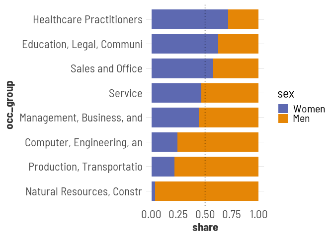

``` r
wages |>
  filter(univ == "full",
         name == "Connecticut",
         dim == "sex_x_occ") |>
  group_by(occ_group) |>
  filter(!any(is_small)) |>
  ungroup() |>
  group_by(c(occ_group)) |>
  mutate(share = count / sum(count)) |>
  filter(!any(share == 0)) |>
  ungroup() |>
  filter(sex == "Women") |>
  ggplot(aes(x = share, y = earn_q50, size = count)) +
  geom_point(alpha = 0.8) +
  scale_size_area()
```

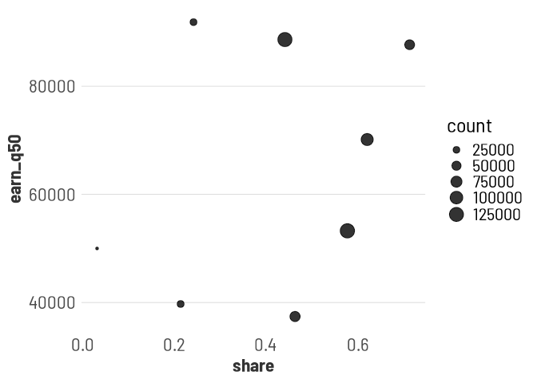

#### wages by occupation x sex

``` r
out[["full_by_sex_x_occ"]] <- wages |>
  filter(univ == "full",
         dim == "sex_x_occ") |>
  group_by(name, occ_group) |>
  filter(!any(is_small)) |>
  ungroup() |>
  select(univ:occ_group, income = earn_q50) |>
  mutate(occ_group = fct_reorder(occ_group, income, .fun = max)) |>
  arrange(occ_group)

make_dots(filter(out$full_by_sex_x_occ, name == "Connecticut"), x = occ_group) +
  scale_x_discrete(labels = \(x) substring(x, 1, 25))
```

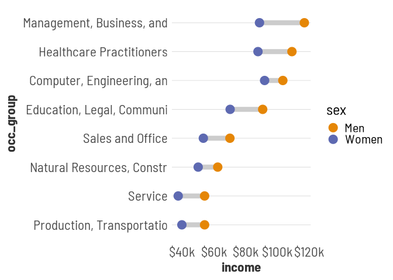

#### wages by occupation x sex x edu

``` r
out[["full_by_sex_x_edu_x_occ"]] <- wages |>
  filter(univ == "full",
         dim == "sex_x_edu_x_occ") |>
  group_by(name, occ_group) |>
  filter(!any(is_small)) |>
  ungroup() |>
  select(univ:occ_group, income = earn_q50) |>
  mutate(occ_group = fct_reorder(occ_group, income, .fun = max)) |>
  arrange(occ_group)

out$full_by_sex_x_edu_x_occ |>
  filter(name == "Connecticut",
         edu %in% c("High school or less", "Graduate degree")) |>
  ggplot(aes(x = edu, y = income, color = sex, shape = edu, group = edu)) +
  geom_path(color = "gray80", linewidth = 2) +
  geom_point(size = 4) +
  scale_y_continuous(labels = scales::label_dollar(scale = 1e-3, suffix = "k")) +
  scale_color_manual(values = pal) +
  coord_flip() +
  facet_grid(rows = vars(fct_rev(occ_group)), switch = "y", 
             labeller = labeller(.rows = \(x) substring(x, 1, 25))) +
  theme(axis.text.y = element_blank(),
        strip.text.y.left = element_text(angle = 0, hjust = 1))
```

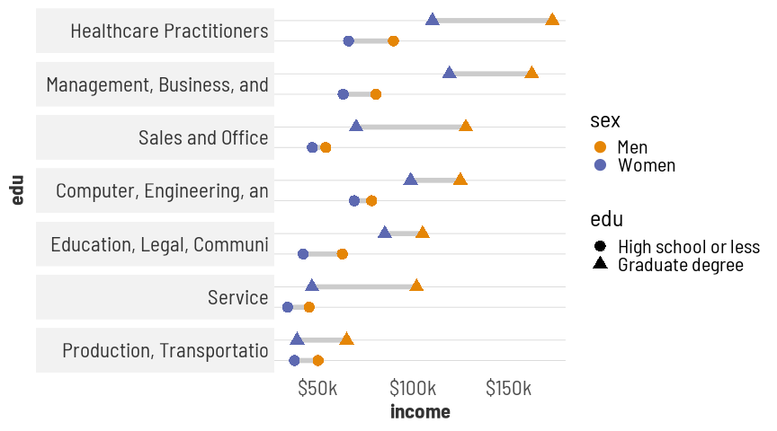

## distribution of individual earnings

``` r
out[["full_quant_by_race_x_sex"]] <- wages |>
  filter(name == "Connecticut",
         univ == "full",
         dim %in% c("sex", "race_x_sex")) |>
  pivot_longer(matches("^earn_q\\d+$"), names_to = c(NA, "quant"), names_sep = "_") |>
  select(univ:occ_group, quant, income = value)

out$full_quant_by_race_x_sex |>
  mutate(quant_num = parse_number(quant)) |>
  mutate(bracket = 50 - abs(50 - quant_num)) |>
  make_quants()
```

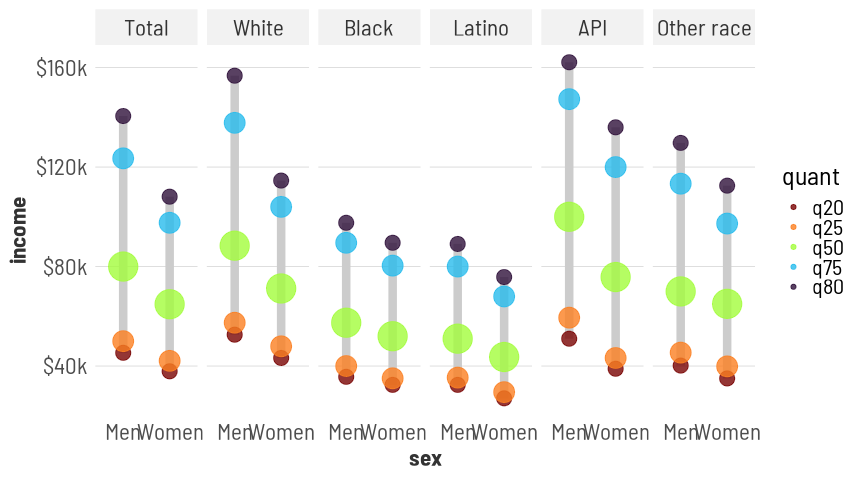

Full-time working Black & Latina women’s 80th percentile incomes are
lower than white & Asian men’s medians

``` r
wages |>
  filter(name == "Connecticut",
         (univ == "full" & dim %in% c("sex", "race_x_sex")) | (univ == "all" & dim %in% c("total", "time"))) |>
  mutate(ratio_80_20 = earn_q80 / earn_q20) |>
  select(univ, sex, race, earn_q20, earn_q80, ratio_80_20) |>
  arrange(desc(ratio_80_20)) |>
  print(n = Inf)
```

    # A tibble: 15 × 6
       univ  sex   race       earn_q20 earn_q80 ratio_80_20
       <fct> <fct> <fct>         <dbl>    <dbl>       <dbl>
     1 all   Total Total          8183    52608        6.43
     2 all   Total Total         24000   108091        4.50
     3 full  Women API           38913   135977        3.49
     4 full  Men   Other race    40188   129709        3.23
     5 full  Women Other race    35022   112525        3.21
     6 full  Men   API           50991   162137        3.18
     7 full  Men   Total         45326   140519        3.10
     8 all   Total Total         41075   124645        3.03
     9 full  Men   White         52608   156732        2.98
    10 full  Women Total         37891   108091        2.85
    11 full  Women Latino        27023    75782        2.80
    12 full  Women Black         32427    89561        2.76
    13 full  Men   Latino        32427    89082        2.75
    14 full  Men   Black         35670    97598        2.74
    15 full  Women White         43255   114568        2.65

ratios to median men’s pay are higher at lower levels except for API
women, i.e. gaps are wider at higher incomes, but not huge differences.

``` r
distros |>
  filter(sex != "Total") |>
  # filter(race == "Total") |>
  group_by(name, sex, race) |>
  mutate(share = count / sum(count)) |>
  filter(lower < 5e5) |>
  ggplot(aes(x = lower, y = share, fill = sex)) +
  geom_col(position = position_identity(), alpha = 0.4) +
  # scale_x_log10() +
  facet_grid(rows = vars(race)) +
  scale_fill_manual(values = pal, aesthetics = c("fill", "color"))
```

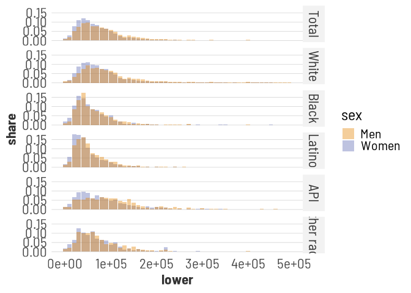

lol I spent a bunch of time figuring this out and it’s kinda useless

## output

``` r
out_tbls <- out |>
  map(function(df) {
    if (unique(df$univ) == "full") {
      df |> filter(name == "Connecticut")
    } else {
      df
    }
  })

saveRDS(out_tbls, here::here("output_data/wage_gap_tbls.rds"))
# jsonlite::write_json(out_tbls, here::here("output_data/wage_gap_tbls.json"))
```
